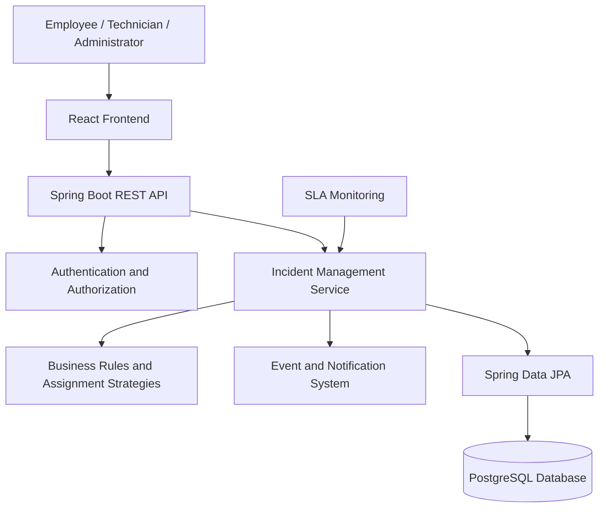

<div align="center">

# NEXUS

### Intelligent IT Operations & Incident Management

**A unified platform for incident reporting, intelligent technician assignment, SLA monitoring, and IT service management.**

Object-Oriented Programming Course Project  
**BITS Pilani, Hyderabad Campus**

**Java 21 • Spring Boot • React • PostgreSQL • Docker**

</div>

---

## Overview

NEXUS is a full-stack IT incident management platform designed to streamline how technical issues are reported, assigned, tracked, and resolved.

Traditional IT support workflows often suffer from fragmented communication, delayed issue resolution, and limited operational visibility. NEXUS addresses these challenges through a centralized system connecting employees, technicians, and administrators.

The application combines Java-based object-oriented design, automated incident workflows, role-based access control, operational analytics, and configurable administrative tools.

## Key Features

### 1. Role-Based Access Control

NEXUS provides three dedicated user environments.

**Employee Portal**
- Secure registration and login
- Incident creation and tracking
- Automatic priority calculation
- Incident status and history
- Communication with assigned technicians
- Resolution verification and ticket closure
- In-app notifications

**Technician Portal**
- Assigned incident dashboard
- Incident acknowledgment and investigation
- Progress updates
- Information requests and private notes
- Incident resolution
- Availability management
- Workload visibility

**Administrator Portal**
- Centralized system monitoring
- Employee and technician management
- Service and category configuration
- SLA policy administration
- Assignment strategy configuration
- Incident analytics and reporting
- Service dependency visualization
- Audit history and operational oversight

### 2. Intelligent Incident Management

NEXUS supports a structured incident lifecycle:

1. An employee reports an incident.
2. The system calculates priority using impact and urgency.
3. An assignment strategy evaluates eligible technicians.
4. The assigned technician acknowledges the incident.
5. The technician investigates and resolves the issue.
6. The employee verifies or reopens the incident.
7. The incident is closed with an audit trail.

### 3. Intelligent Technician Assignment

The system supports two assignment strategies:

- **Skill-Based Assignment:** Prioritizes technicians with relevant expertise.
- **Load-Based Assignment:** Considers technician workload to distribute incidents.

The Strategy design pattern allows administrators to select different assignment algorithms without modifying the core incident management logic.

### 4. SLA Monitoring

NEXUS supports configurable Service Level Agreements for incident response and resolution.

Features include:
- Priority-based SLA policies
- Deadline tracking
- SLA warnings
- Breach detection
- Escalation workflows
- Audit records

### 5. Notifications and Communication

The application uses event-driven notifications to keep users informed about incident activity.

- In-app notifications
- Persistent notification history
- Simulated email outbox
- Optional external email integration
- Incident communication history

### 6. Operational Analytics

The administrator dashboard provides tools for understanding system activity.

- Incident distribution and trends
- Technician workload analysis
- SLA risk monitoring
- Service dependency visualization
- Decision Inspector
- Audit history
- Incident replay

### 7. Service Dependency Analysis

NEXUS models dependencies between IT services, helping administrators investigate related incidents and potential upstream service failures.

### 8. Security

- Role-based access control
- Session-based authentication
- CSRF protection
- Password hashing
- Server-side authorization
- Protected application endpoints

---

## Object-Oriented Programming Concepts

The core application logic is implemented in Java using object-oriented principles and established design patterns.

| Concept | Implementation |
|---------|----------------|
| Encapsulation | Incident lifecycle and business rules |
| Abstraction | Abstract Account model |
| Inheritance | Employee, Technician, Administrator |
| Polymorphism | Interchangeable assignment strategies |
| Strategy Pattern | Skill-based and load-based assignment |
| Observer Pattern | Event-driven audit and notifications |
| Repository Pattern | Persistence through Spring Data JPA |
| Separation of Concerns | Domain, service, repository, and controller layers |

The application emphasizes modularity, reusable components, maintainability, and separation of business logic from presentation.

## Technology Stack

| Layer | Technology |
|-------|------------|
| Backend | Java 21, Spring Boot 3.4.5 |
| Frontend | React 18, Vite |
| Database | PostgreSQL |
| Persistence | Spring Data JPA |
| Visualization | ECharts, React Flow |
| Security | Spring Security |
| Build Tools | Maven, npm |
| Containerization | Docker |
| Cloud Hosting | Render |

## System Architecture



NEXUS follows a layered architecture that separates the presentation layer, REST controllers, service logic, domain models, and persistence.

## Repository Structure

```text
NEXUS/
├── backend/          Java Spring Boot application
├── frontend/         React application
├── docs/             Architecture and API documentation
├── scripts/          Setup, build, and startup scripts
├── tests/            Java core tests
├── Dockerfile        Container deployment
├── render.yaml       Render deployment configuration
└── README.md
```

---

## Getting Started

### Prerequisites

- Java 21
- Maven
- Node.js and npm
- PostgreSQL database
- Git

### Clone the Repository

```bash
git clone https://github.com/anantagarwal0156H/NEXUS.git
cd NEXUS
```

### Configure the Application

```bash
bash scripts/configure.sh
```

Provide the required database connection details when prompted.

Use a dedicated database and keep credentials private.

### Build the Application

```bash
bash scripts/build.sh
```

### Start NEXUS

```bash
bash scripts/start.sh
```

The application will be available at:

http://localhost:8080

Health check:

http://localhost:8080/health

### Frontend Development

With the backend running:

```bash
cd frontend
npm install
npm run dev
```

---

## Cloud Deployment

NEXUS uses a Docker-based deployment on Render.

The frontend is built into the Spring Boot application's static resources, allowing the combined application to be served through a single deployment.

### Deployment Optimization

Render's free-tier infrastructure may suspend inactive services, introducing cold-start delays.

To mitigate this limitation, an external monitoring service such as UptimeRobot can periodically request the application health endpoint.

A 10-minute monitoring interval can help prevent inactivity-based shutdowns, although availability remains subject to hosting limitations and free-tier resource allowances.

This approach helps improve responsiveness without modifying the application's core business logic.

---

## Testing and Validation

The repository includes:

- Java business-rule tests
- Incident lifecycle validation
- Assignment algorithm checks
- Priority calculation checks
- SLA calculation checks
- API and role-based workflow test scenarios

The initial recorded core test run contains **33 passing Java checks**. Additional end-to-end tests must be verified against the current deployment.

See [TEST_RESULTS.md](TEST_RESULTS.md) for test evidence and outstanding verification requirements.

## Documentation

- [System Architecture](docs/architecture.md)
- [API Documentation](docs/API.md)
- [Demonstration Guide](docs/DEMO.md)
- [OOP Implementation Guide](TEAM_GUIDE.md)
- [Requirements Coverage](RUBRIC_COVERAGE.md)
- [Test Results](TEST_RESULTS.md)

## Project Scope

NEXUS is an academic prototype demonstrating full-stack application development, object-oriented software design, database persistence, role-based workflows, and cloud deployment.

The system uses application-generated incident records rather than live infrastructure monitoring.

Production-scale deployment would require further security hardening, scalability testing, and infrastructure optimization.

---

<div align="center">

### NEXUS

**From Incident Reporting to Accountable Resolution**

*Object-Oriented Programming Course Project*

**BITS Pilani, Hyderabad Campus**

</div>

