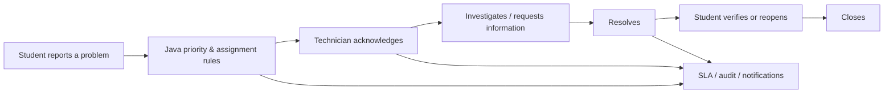
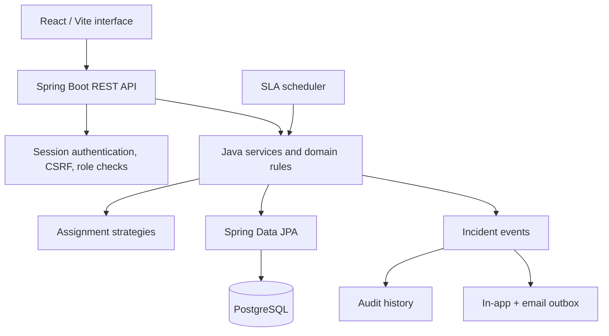

# NEXUS
### Your campus. In sync.

**A campus incident-management and operations platform.**  
Report problems. Coordinate responses. Track resolution. Understand the bigger picture.

**BITS Pilani, Hyderabad Campus · Object-Oriented Programming Course Project**

Java 21 · Spring Boot · React · PostgreSQL · Render

---

## What is NEXUS?

NEXUS brings campus support into one connected workspace. Students can report issues with a relevant building or service; technicians can take ownership of assigned work; administrators can oversee tickets, SLA deadlines, service dependencies, and campus-wide activity.

It is **not** a static website or a simulated dashboard: the application has a Java backend, a PostgreSQL data model, role-restricted API actions, and a React interface. Campus and service data are demonstrative, not live infrastructure telemetry.

> **Current repository baseline:** V6.1 Glass Operations release (20 November 2026), with subsequent landing-page and admin Incident Centre refinements (21 November 2026). Version names also appear in retained module filenames; those are implementation history, not separate deployed applications.

## The experience

| Student / employee workspace | Technician workspace | Administrator workspace |
| --- | --- | --- |
| Submit and track incidents, select campus locations, receive status updates, provide verification | Acknowledge and investigate assignments, request information, record private notes, resolve incidents | Monitor incidents and SLAs, manage users and policies, inspect the service graph, analytics, and audit history |

The sign-in experience and workspaces use a **Glass Operations UI**, with an interactive campus map and a customizable **Theme Centre** (presets, accents, density, and surface styling).

### From report to resolution

### Highlights in the current code

- **Smart incident reporting:** service, category, impact, urgency and campus location; preview of calculated priority and potential duplicates.
- **Campus location support:** map and building selection; optional browser geolocation to suggest a nearby site. A pilot location check is required for resolution of certain location-tagged tickets.
- **Intelligent assignment:** switchable skill-based and load-based technician ranking.
- **SLA monitoring:** response and resolution deadlines, warning/breach events and P1 escalation behavior.
- **Role-safe collaboration:** updates, technician private notes, notifications and incident audit trail.
- **Operations command centre:** incident trends, workloads, service dependencies, topology explorer, Decision Inspector and ticket-history replay.
- **Theme Centre:** multiple visual presets and adjustable interface settings.
- **Optional smart report assistant:** an opt-in suggestion endpoint that falls back to local rules if external AI is disabled or unavailable. External AI needs explicit server configuration; it is **not required** for the main workflow.

The service dependency graph is **illustrative and incident-derived**; it does not claim to monitor the campus network or physical assets in real time.

## Object-oriented engineering

NEXUS makes Java—not the browser—the authority for incident transitions, assignment and authorization.

| OOP concept / pattern | Where to see it |
| --- | --- |
| **Abstraction & inheritance** | `domain/Account.java` and its `Employee`, `Technician`, `Administrator` subclasses |
| **Encapsulation** | `domain/Incident.java` controls status transitions |
| **Polymorphism / Strategy** | `strategy/AssignmentStrategy.java` with skill-based and load-based implementations |
| **Observer / events** | `event/IncidentEvent.java`, `EventListeners.java` and notification channels |
| **Repository** | Spring Data JPA interfaces in `data/` |
| **Service-layer composition** | `service/IncidentService.java` coordinates rules, persistence and events |
| **Algorithms** | Priority and similarity rules; dependency traversal in `domain/Rules.java` |

See [OOP walkthrough](TEAM_GUIDE.md), [architecture](docs/architecture.md) and [engineering decisions](DECISIONS.md).

## Architecture

The current Render deployment builds the React frontend **into the Spring Boot application**, then serves both through the same Docker-based web service. It is *not* deployed as a separate Vercel frontend.

## Technology

**Backend:** Java 21, Spring Boot 3.4.5, Spring Security, JPA, Maven  
**Frontend:** React 18, Vite 6, ECharts, React Flow, Leaflet / OpenStreetMap  
**Database:** PostgreSQL  
**Infrastructure:** Docker, Render  
**Optional integrations:** restricted email delivery via Resend; opt-in AI assistance via Groq configuration

## Live deployment

NEXUS has been deployed to Render as a combined application. The repository does not currently record a verified public app URL; use the URL supplied with the course submission rather than a guessed link.

**Availability note:** Render's free service may spin down after inactivity. An external HTTP monitor can reduce inactivity-related cold starts, but cannot guarantee continuous availability. The server exposes `/health` for readiness checks.

## Evidence and scope

- The repository contains JUnit and standalone Java checks. The [recorded core-test evidence](TEST_RESULTS.md) is from an earlier implementation snapshot; it must not be mistaken for full V6.1 end-to-end certification.
- Features listed here are **code-backed**, not a claim that every production workflow has passed a fresh browser test.
- Demo incidents and campus topology are illustrative. Historical replay reconstructs recorded ticket states, not a complete campus-wide time machine.
- NEXUS is an academic prototype, not a production-hardened campus IT deployment.

## Explore the repository

| Read | Purpose |
| --- | --- |
| [Current implementation overview](STATUS.md) | Version baseline and verified vs. unverified claims |
| [Architecture](docs/architecture.md) | Layers, classes and flow |
| [Walkthrough](docs/DEMO.md) | Student → technician → admin scenario |
| [OOP guide](TEAM_GUIDE.md) | Code landmarks for the viva |
| [API reference](docs/API.md) | API routes and authorization |
| [Feature coverage](RUBRIC_COVERAGE.md) | Requirements mapped to source |
| [Test evidence](TEST_RESULTS.md) | What was actually tested |
| [Engineering decisions](DECISIONS.md) | Design tradeoffs |

*Developer run scripts remain in `scripts/` for maintainers; this README is intentionally a project showcase rather than a localhost installation tutorial.*

---

**NEXUS — Report. Route. Resolve.**

Built for the Object-Oriented Programming course at **BITS Pilani, Hyderabad Campus**.

