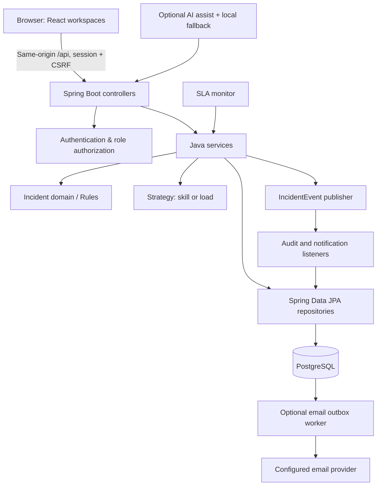

# NEXUS V6.1 — Architecture

## Runtime model

The frontend is a React/Vite build compiled into the Spring Boot static resources. A **single Docker container on Render** serves the interface and `/api` routes. PostgreSQL is external persistence. This is not a split Vercel/Render deployment.

## Object model

## Current campus modules

- **Reporting:** `IncidentController` accepts campus location codes and notes alongside incident details. `CampusCatalog` supplies illustrative sites.
- **Location assistance:** `campus.jsx` uses browser geolocation only when requested; `GeoCheck` compares against configured coordinates for designated resolution flows.
- **Operational topology:** `Infrastructure` produces dependencies and suspected common causes from service records and incidents; `CampusTopologyV6` can add a predefined illustrative campus-access network when enabled or explicitly applied by an admin.
- **AI report suggestions:** `SmartReport` performs consent and input checks, optionally queries a configured provider, and returns a rules-based fallback.
- **Interface:** `login-refined.jsx`, `appearance.jsx`, `command-v4.jsx`, `campus.jsx`, and components retained in `v2.jsx` are all part of the current application.

## Persistence and invariants

The database holds accounts, technician skills, IT services, service dependencies, categories, incidents, SLA policies, audit history, notifications and settings. Domain methods enforce lifecycle transitions; controllers/services enforce visibility and permissions. Source code currently uses JPA/Hibernate auto-update rather than a versioned migration tool.

### Scope and limitations

Dependencies are modeled relationships, not real-time telemetry. Replay reconstructs **ticket state** from historical audit events. External email/AI require separate configuration; local fallbacks are not equivalent to confirmed third-party delivery.

See [API reference](API.md), [engineering decisions](../DECISIONS.md), and [test evidence](../TEST_RESULTS.md).
