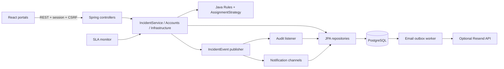
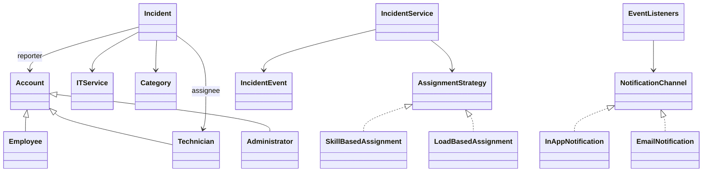

# Architecture and diagram source

Database: accounts (single-table inheritance), technician_skills keyed by account/category, it_services, service_dependencies (dependent to provider IDs), categories, incidents (reporter/tech/service/category associations), incident_relations, sla_policies, audit logs, notifications and settings. See entity annotations for physical names/columns. Logical relationships from incident ID / recipient ID in notice and audit are scalar references rather than enforced foreign keys. Use the actual generated schema for final report ERD.

Use cases: Employee -> register/login, report, track, communicate, verify/reopen/close; Technician -> assigned queue, acknowledge, investigate, request info, resolve, availability; Administrator -> monitor, manage users/categories/services/SLA and strategies, assign, correlate, audit, replay, reports. All -> authorized inbox.
